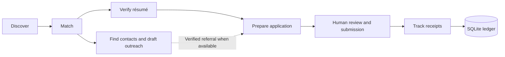

# JobApply

JobApply is a local workflow engine for coordinating the stages of a job search. A coordinator dispatches versioned JSON tasks to specialized workers. A SQLite ledger checks their results, records changes, and builds review queues for the applicant.

## Run the demo

Requires Python 3.11+, SQLite 3.37+, and the IANA timezone database. On systems without timezone data, install `tzdata` in your Python environment. The demo runs offline with fictional jobs, a sample résumé, and simulated worker results.

```bash
python3 demo.py
python3 demo.py --with-receipt
python3 -m unittest discover -s tests -p 'test_*.py'
```

The first command walks one position from discovery to a human review handoff. Two listings for the same requisition converge into one job. The workflow reuses the approved résumé by hash and recovers a blocked preparation task after a simulated user action. The second command also plays back a simulated receipt and shows the same role is ineligible for another application. Each run prints its output directory. Open `report.html` there to inspect the workflow, or use `summary.json`, the SQLite ledger, and the individual task and result envelopes.

## Run one real cycle in Codex

1. Clone the project and open the checkout as the working directory in Codex. The English coordinator and worker skills live under `.agents/skills/`. [Codex skill discovery](https://learn.chatgpt.com/docs/build-skills#where-codex-loads-local-skills)
2. Create the private workspace and copy the configuration template.

   ```bash
   mkdir -p .jobapply/resume
   cp config.example.json .jobapply/config.json
   ```

3. Put your approved PDF at `.jobapply/resume/Candidate Resume.pdf`, or set `resume.path` relative to `.jobapply/`. Set `candidate.graduation_month` to the PDF's real `YYYY-MM` value and review the other candidate facts. You can leave an unconfirmed answer as `null`. The run pins the PDF's SHA-256. You can also provide the expected hash in `resume.sha256`.
4. For a first run, turn on `capabilities.web_research` and find an official job posting you want to assess. In Codex, ask:

   ```text
   Use $jobapply-run to run one live cycle for <official HTTPS job URL>.
   Use subagents for the stage tasks and stop at human review.
   ```

   This starts with the one supplied link, checks the employer's actual JD, and runs it through matching, the ledger, and any enabled downstream stages. A run can also check sources listed in the private configuration. The configured limits bound source coverage and the number of jobs.
5. For live form preparation, turn on `capabilities.prepare_forms`, explicitly request preparation, and provide an authorized browser session if the site requires it. The coordinator leaves actual submission and personal attestations to you. `capabilities.contact_research` enables draft-only outreach. `capabilities.mail_read` enables targeted receipt checks with an approved mailbox tool. Enable only the channels you want the run to use.

A Codex host with access to public web research can do the posting and match stages. Browser forms and mailbox tracking depend on the tools available to that session and on the applicant's access to the provider. The role skills also support sequential execution on a host that does not expose subagents. The local launcher creates the private ledger and hands the coordinator task paths. It can be run directly to inspect the starting queue:

```bash
python3 scripts/jobapply_start.py --config .jobapply/config.json --lead '<official HTTPS job URL>'
```

Reports and handoffs are local to `.jobapply/`, including `positions/discovered.csv`, `reports.json`, and the accepted task results. See the [worker handoff contract](docs/worker-contract.md) for the file protocol.

## How it works



| Concern | Implementation |
| --- | --- |
| Identity and freshness | Merge listings by employer and official requisition, retain the earliest primary posting evidence, and store explicit repost evidence separately. |
| Worker coordination | Pin inputs to a JD revision and résumé hash. Validate task identity, attempts, and artifacts before accepting a result. |
| Recovery | Keep qualifying jobs in the workflow after discovery windows expire. Preserve valid form references across retries and reject stale inputs. |
| Human handoff | Record when a form is ready for review. Associate a receipt with a specific position before counting the application as submitted. |
| Reporting | Export CSV views and structured worksheet data from the ledger. Escape spreadsheet formula prefixes in CSV cells. |

The [architecture notes](docs/architecture.md) describe the wire format and the state transitions. The coordinator routes each stage to the corresponding English Codex skill. Workers using provider tools return the same envelopes as the offline fixtures.

## Data boundaries

The repository contains source, English skills, documentation, tests, and a fixture generator. Keep real résumés, applicant answers, inbox evidence, contact drafts, browser references, and exports under the Git-ignored `.jobapply/` directory. Credentials belong in your provider session or connector.
