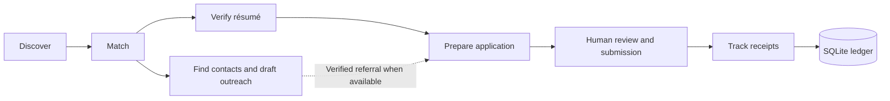

# JobApply

JobApply is a local workflow engine for coordinating the stages of a job search. A coordinator dispatches versioned JSON tasks to specialized workers. A SQLite ledger checks their results, records changes, and builds review queues for the applicant.

## Run the demo

Requires Python 3.11+, SQLite 3.37+, and the IANA timezone database. On systems without timezone data, install `tzdata` in your Python environment. The demo runs offline with fictional jobs, a sample résumé, and simulated worker results.

```bash
python3 demo.py
python3 demo.py --with-receipt
python3 -m unittest discover -s tests -p 'test_*.py'
```

The first command walks one position from discovery to a human review handoff. Two listings for the same requisition converge into one job. The workflow reuses the approved résumé by hash and recovers a blocked preparation task after a simulated user action. The second command also plays back a simulated receipt and shows the same role is ineligible for another application. Each run prints its output directory. Open `report.html` there to inspect the workflow, or use `summary.json`, the SQLite ledger, and the individual task and result envelopes.

## How it works



| Concern | Implementation |
| --- | --- |
| Identity and freshness | Merge listings by employer and official requisition, retain the earliest primary posting evidence, and store explicit repost evidence separately. |
| Worker coordination | Pin inputs to a JD revision and résumé hash. Validate task identity, attempts, and artifacts before accepting a result. |
| Recovery | Keep qualifying jobs in the workflow after discovery windows expire. Preserve valid form references across retries and reject stale inputs. |
| Human handoff | Record when a form is ready for review. Associate a receipt with a specific position before counting the application as submitted. |
| Reporting | Export CSV views and structured worksheet data from the ledger. Escape spreadsheet formula prefixes in CSV cells. |

The [architecture notes](docs/architecture.md) describe the wire format and the state transitions. The checked-in code covers the coordinator, SQLite state, and offline replay. Live account integrations use separate workers.

## Data boundaries

The repository contains source, tests, and a fixture generator. Runtime records are generated locally. Real résumés, inbox evidence, contact drafts, browser references, and exports belong in a private workspace.
